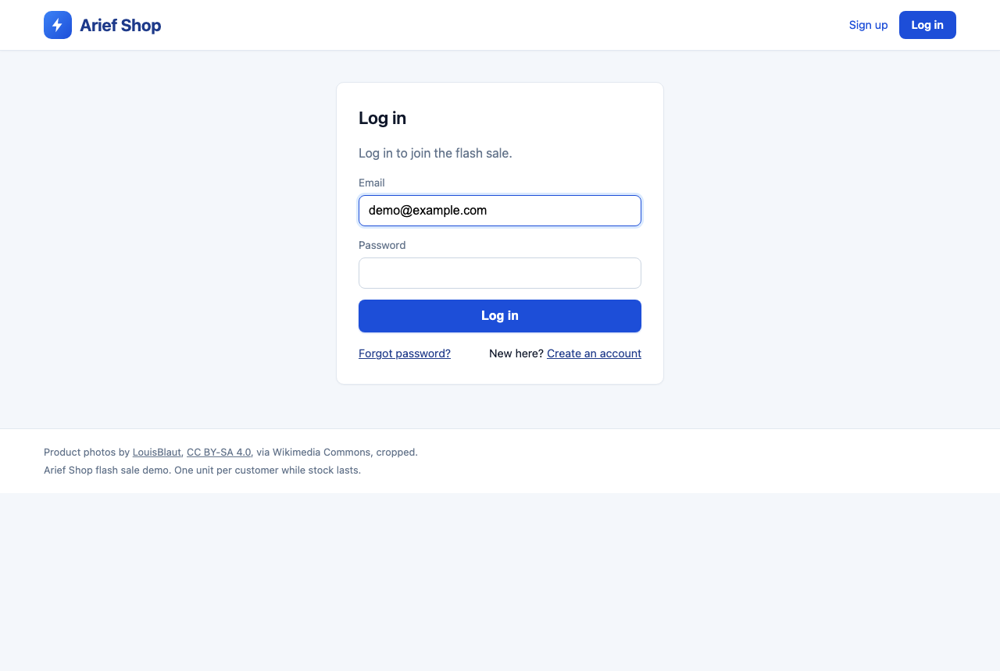
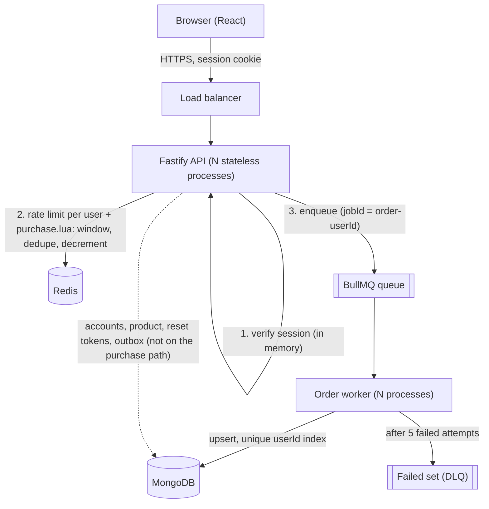
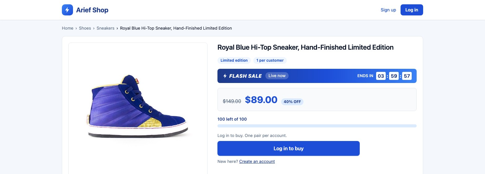
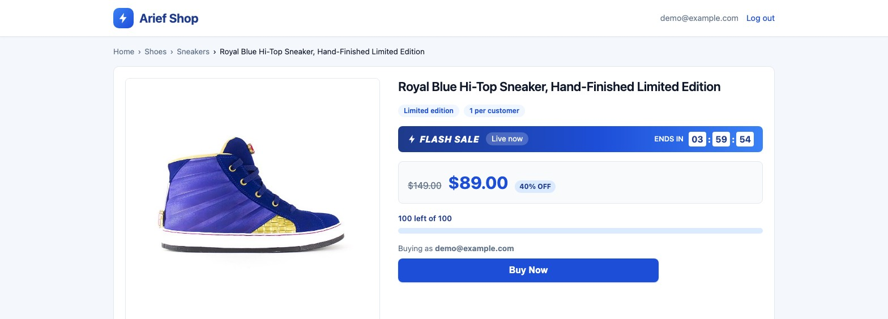
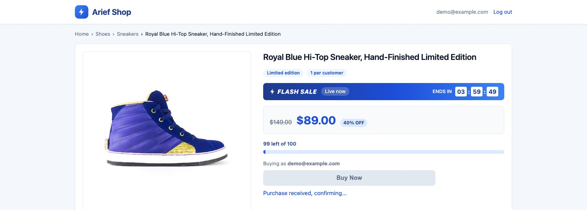
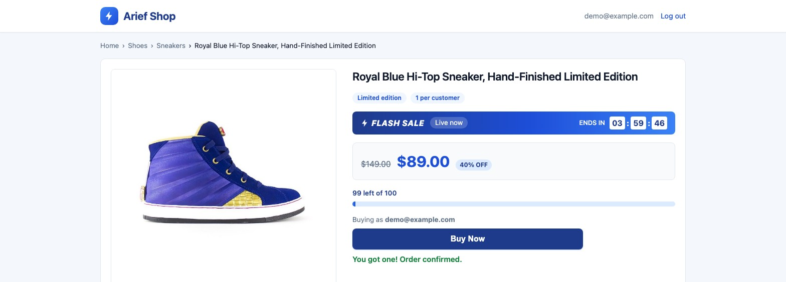
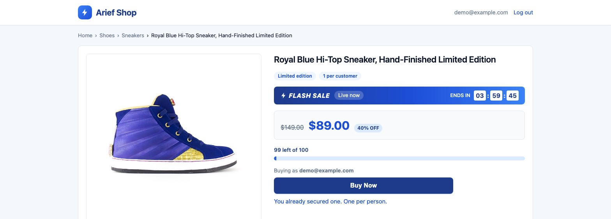
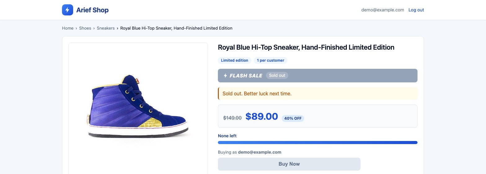
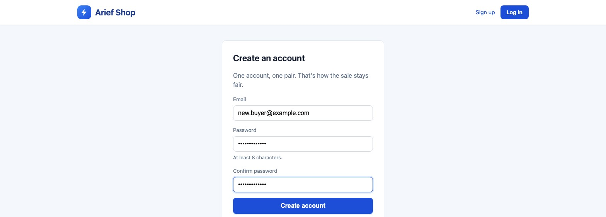
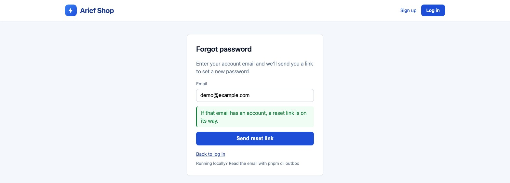

# Arief Shop: Flash Sale System

A flash sale for one limited-edition product: a configurable sale window, fixed stock, one unit per account, built to hold up when thousands of people press "Buy Now" in the same second. Fastify API, BullMQ worker, React storefront, Redis for the hot path, MongoDB for the durable record, in a pnpm + Turborepo monorepo.

| Shop | Log in |
|---|---|
|  |  |

## Test account

| Email | Password |
|---|---|
| `demo@example.com` | `FlashSale2026!` |

Created by `pnpm cli seed`, which also resets its password, so this login always works on a freshly seeded dev setup. Development only; never seed it into a real deployment. You can also sign up with any email on the site.

## Quick start

Needs Node 20+, pnpm, and Redis + MongoDB (Docker or local installs).

```bash
docker compose up -d        # Redis + MongoDB (or run redis-server / mongod yourself)
cp .env.example .env        # working defaults for local development
pnpm install
pnpm build                  # builds packages/core first; the apps import its compiled output
pnpm cli seed               # indexes, product, sale window (starts in 1 minute), demo account
pnpm dev                    # API :3000, worker, web :5173
```

Open http://localhost:5173 and log in with the test account. To start the sale right now instead of in a minute: `pnpm cli seed --force --start now --minutes 60`.

## How it works

A purchase never touches the database. The API checks the session cookie (a signature check in memory), then runs one atomic Redis Lua script that checks the sale window against Redis's own clock, checks whether this account already bought, checks stock, and decrements, all in one round trip. Two requests racing for the last unit can't both win. A winner is handed to a queue (BullMQ, on the same Redis); a worker confirms it into MongoDB. Everything else (product details, accounts, password resets) lives off that path.



The full writeup, with a request walkthrough, failure handling, and measured scaling, is in [`docs/architecture.md`](docs/architecture.md). Each major decision has an ADR in [`docs/adr/`](docs/adr/README.md).

## The flow

Captured in a real browser against the running stack.

| | |
|---|---|
|  **1. Logged out.** The sale is live; buying needs an account. |  **2. Log in.** |
|  **3. Logged in.** "Buying as" shows who the purchase is for. |  **4. Pending.** The unit is reserved in Redis; the worker hasn't confirmed it yet. |
|  **5. Confirmed.** Stock drops to 99. |  **6. Second click.** One per account. |
|  **7. Sold out.** The button disables and the page says why. |  **8. Sign up.** |
|  **9. Forgot password.** Same answer whether or not the email has an account. |  **10. Reset password**, from the emailed one-time link. |

On a phone it stacks into one column: [screenshot](apps/docs/images/shop-mobile.png).

## Repo structure

```
apps/
  api/       Fastify: sale status, purchase, accounts, product. Cluster mode via API_PROCESSES.
  worker/    BullMQ consumer: confirms reserved orders into MongoDB.
  web/       React storefront: shop page plus log in, sign up, forgot and reset password.
             public/ holds the favicon, robots.txt and product photos. e2e/ is Playwright.
  cli/       pnpm cli: seed, clean up, inject product, accounts, outbox, DLQ replay, reconcile.
  docs/      Mintlify docs site (pnpm docs). images/ holds every screenshot in this README.
packages/
  core/      The rules, shared by everything: Lua purchase gate, Redis keys, job options,
             orders, product, users, sessions, password reset tokens, outbox.
stress/      Load harness: 26,000 requests, then invariant checks against Redis and Mongo.
tests/python/ Black-box contract tests (pytest) against the running API.
postman/     Postman collection + local environment (pnpm test:postman runs it with newman).
docs/
  architecture.md   diagram, request walkthrough, failure handling, measured scaling
  adr/              one record per major decision
  PRD.md            the original design spec
.claude/agents/     subagents for parallel work, one per package plus a read-only verifier
.claude/skills/     how-tos: ADRs, API changes, reading the databases, CodeGraph, style, git, stack, frontend
.claude/plugins/flash-sale-arief/  Claude plugin: investigate, app-server-mutation-testing, verify-and-log
AGENTS.md           the same rules for non-Claude agents
agent-os/           Agent OS: product mission and roadmap, standards, spec/task commands
docs/superpowers/plans/  implementation plans for the work in this repo; .pi/plans/ for Pi
.serena/, .mcp.json Serena code-navigation MCP server for this project (dashboard off)
.husky/             pre-commit: lint-staged (eslint --fix); pre-push: typecheck + spec drift
.vscode/, .tools/   debug configs and recommended extensions; mutation runs on changed packages only
PERFORMANCE_REVIEW.md   hot path cost, measured numbers, knobs, next levers
REPOSITORY_ANALYSIS.md  size, test coverage, risks and debt
CLAUDE.md           how to work in this repo; each package has its own CLAUDE.md too
```

## What it does

**The sale, per the brief**
- Configurable start and end time; purchases outside the window are refused (`upcoming` / `ended`), checked inside Redis against Redis's clock so several API processes can't disagree.
- One product, fixed stock, never oversold, enforced by one atomic Lua script.
- One unit per account, enforced in the same script.
- No duplicate orders, at three layers: the Lua gate records the buyer atomically, the queue job id is fixed per account (a second enqueue is dropped), and the order write is an upsert on a unique index. On top of that, `Idempotency-Key` makes a retried request safe: the web app sends a fresh key per click and retries once on a network error with the same key, so a lost response comes back as the original "pending" instead of "already purchased".
- Status, purchase, and "did I get one" endpoints; a storefront showing live status, countdown, stock, and every outcome.

**Accounts**
- Sign up, log in, log out. Buy Now uses the logged-in account, so nobody can buy as someone else by typing their id.
- Forgot password emails a link that works once and expires in 30 minutes. There's no mail provider in this demo: email lands in an outbox collection, readable with `pnpm cli outbox` (the brief allows mocking cloud services). Swapping in SES or SendGrid replaces one function.

**Storefront**
- Product page in a blue and white theme (colors are tokens on `:root` in `apps/web/src/index.css`): gallery, flash-sale bar with countdown, price with discount, stock meter, specs. Works down to phone width.
- SEO: title, meta description, canonical, Open Graph, schema.org Product JSON-LD with live availability, robots.txt; account pages are `noindex`.
- Photos by LouisBlaut, CC BY-SA 4.0, via Wikimedia Commons, cropped; credited in the page footer and `apps/web/public/products/CREDITS.md`.

**Security**
- Passwords hashed with scrypt, compared in constant time. Login failures give one message, and checking an unknown email costs the same time as a wrong password, so neither reveals which emails have accounts.
- Sessions are signed JWTs (HS256 pinned, so `alg: none` and other-algorithm tokens are rejected) in an `httpOnly`, `SameSite=Strict`, `Secure`-in-production cookie: page scripts can't read it, and other sites can't make the browser send it.
- Reset tokens are stored only as a hash, single use even under a race, and Mongo expires them on its own.
- Rate limits: purchases per account (people behind one office IP don't block each other), log in / sign up / reset per IP per minute.
- Anti-clickjacking: `X-Frame-Options: DENY` and CSP `frame-ancestors 'none'` on the API (errors included) and the web server; the production preview adds a full CSP (no inline scripts), checked with zero violations. Whatever serves the built site in production must send these headers too, because `frame-ancestors` can't be set from HTML.
- The API refuses to start in production without its own `AUTH_SECRET`.

**Resilience**
- Redis down: every route that needs it answers 503 in milliseconds, decided from the client's connection state before any command is sent; the product page still renders. Mongo down: 503 within 2 s instead of 30. The worker keeps longer retries so a short blip doesn't fill the DLQ.
- A saturated process sheds requests with 503 + `retry-after` instead of slowing down for everyone. Shedding happens before the purchase gate, so a shed request never holds a unit. ADR 0011.
- Graceful shutdown: on SIGTERM the API stops accepting, finishes in-flight requests, then closes the queue, Redis and Mongo; the worker finishes active jobs first. 10 s deadline, then exit 1. ADR 0012.

**Diagnostics (off by default)**
- `FREEZE_PROFILER=1`: saves a CPU profile of any 10 s window where the event loop stalled past `FREEZE_THRESHOLD_MS`. Local folder or S3; with `ANTHROPIC_API_KEY`, a short AI explanation beside it. [`apps/api/src/libs/freeze-profiler`](apps/api/src/libs/freeze-profiler/README.md)
- `MEMORY_TRACKER=1`: live request objects per route at `GET /debug/memory`, to spot leaks after a stress run. [`apps/api/src/libs/memory-tracker`](apps/api/src/libs/memory-tracker/README.md). ADR 0013.

## API

| Method | Path | Auth | Response |
|---|---|---|---|
| GET | `/api/sale` | no | `{ status, startsAt, endsAt, totalStock, stockLeft }`; status is `upcoming` / `active` / `ended` / `sold_out`. A CDN may cache it 1 s (`s-maxage=1`). |
| GET | `/api/product` | no | Name, price, photos, specs. Cached 60 s in the API and cacheable (`max-age=60`). 404 if not seeded. Still served while Redis is down. |
| POST | `/api/purchase` | yes | 202 `pending`, 409 `already_purchased`, 410 `sold_out`, 403 `upcoming` / `ended`, 401 not logged in, 429 `rate_limited`, 503 `unavailable`. Optional `Idempotency-Key` header: a retry with the same key gets the original response (`Idempotent-Replayed: true`), or 409 `in_progress` while the first is still running. |
| GET | `/api/purchase/me` | yes | `{ userId, status }`; status is `none` / `pending` / `confirmed`. Only your own. |
| POST | `/api/auth/register` | no | `{ email, password }` → 201 and a session cookie; 400 invalid email or weak password; 409 email taken |
| POST | `/api/auth/login` | no | 200 and a session cookie; 401 "Wrong email or password." for every failure |
| POST | `/api/auth/logout` | no | 204, cookie cleared |
| GET | `/api/auth/me` | yes | `{ email }` or 401 |
| POST | `/api/auth/forgot` | no | 202 with the same message whether or not the email has an account |
| POST | `/api/auth/reset` | no | `{ token, password }` → 200 and a session cookie; 400 invalid or expired link |
| GET | `/health` | no | 200 when Redis and Mongo respond, else 503 |
| GET | `/docs` | no | Swagger UI for this table, from `apps/api/openapi.yaml` |

Any route except `/api/product` answers 503 `unavailable` at once while Redis is unreachable, and 503 with `retry-after: 1` while the process is saturated (event loop lag past `MAX_EVENT_LOOP_LAG_MS`). Every response carries the anti-clickjacking and `nosniff` headers. Errors are `{ error, message }`, with `message` meant for people.

## Ops CLI

`pnpm cli` opens a numbered menu. `pnpm cli <command>` runs one directly, for scripts. Commands that delete data ask first (type `yes`), or take `--yes`, and print which databases they'll touch.

| Command | What it does |
|---|---|
| `status` | Sale, product, accounts, buyers, orders and queue at a glance |
| `migrate` | Create Mongo indexes (safe to re-run) |
| `seed [--stock N] [--start ISO\|now] [--end ISO \| --minutes N] [--force]` | Migrate, write the product, seed the sale window and the demo account |
| `product:inject [--file product.json]` | Write the product (validated); default is the built-in one |
| `product:clean` | Remove the product display data |
| `user:create <email> <password>` | Create a login |
| `user:delete <email>` | Delete a login and its purchase data |
| `user:clean <userId>` | Free one account's unit (atomically, back into stock), delete their order and queued job |
| `users:clean` | Delete every order, buyer and queued job; stock back to full |
| `reset` | Delete everything: sale, buyers, queue, orders, product, accounts, emails |
| `dlq:replay` | Move failed jobs back onto the queue |
| `reconcile` | Rebuild Redis buyers and stock from Mongo plus the queue, after a Redis loss |
| `outbox [email]` | Show the latest emails the app sent, e.g. reset links |

`pnpm seed`, `pnpm dlq:replay` and `pnpm reconcile` are shortcuts for the matching commands.

## Configuration

All in `.env` (copy `.env.example`). Defaults work for local development.

| Variable | Default | Notes |
|---|---|---|
| `REDIS_URL`, `MONGO_URL` | localhost | |
| `SALE_START`, `SALE_END`, `SALE_STOCK` | starts in 1 min, runs 1 h, 100 | Read by `pnpm cli seed`; flags override them |
| `PORT` | 3000 | API |
| `API_PROCESSES` | 1 | API processes on this host (cluster mode) |
| `RATE_LIMIT_MAX` | 5 | Purchases per account per second |
| `AUTH_RATE_LIMIT_MAX` | 10 | Log in / sign up / reset attempts per IP per minute |
| `MAX_EVENT_LOOP_LAG_MS` | 200 | Shed requests with 503 past this event loop lag; 0 turns it off |
| `FREEZE_PROFILER`, `FREEZE_THRESHOLD_MS` | off, 500 | Save CPU profiles of event loop stalls |
| `FREEZE_PROFILE_DIR`, `FREEZE_PROFILE_S3_BUCKET` | `profiles`, unset | Where profiles go (S3 uses the standard AWS credentials) |
| `ANTHROPIC_API_KEY` | unset | AI explanation of each captured freeze |
| `MEMORY_TRACKER` | off | `GET /debug/memory` with live objects per route |
| `AUTH_SECRET` | dev value | Signs sessions. Required (32+ chars) in production |
| `WEB_URL` | http://localhost:5173 | Links in reset emails |
| `COOKIE_SECURE` | on in production | Session cookie only over HTTPS |
| `WORKER_CONCURRENCY` | 10 | Jobs per worker process |
| `VITE_SITE_URL` | http://localhost:5173 | Canonical and Open Graph URLs |
| `TEST_REDIS_URL`, `TEST_MONGO_URL` | localhost | Point the test suites at other infra (parallel agents, CI) |

## Tests

| Layer | Command | What it proves | Count |
|---|---|---|---|
| Unit | `pnpm test` | Gate logic, auth (tokens, hashing, forged and expired sessions), idempotency keys, CLI commands and validation, React pages and components | 297 |
| Property-based | part of `pnpm test` | fast-check runs hundreds of random purchase/release sequences and concurrent bursts against a plain reference model of the rules | 7 properties |
| Integration | `pnpm test:integration` | Every endpoint and status code, idempotent retries and concurrent duplicates, real Redis and Mongo, the cluster entry point, a real BullMQ worker and DLQ, every CLI command | 141 |
| Mutation | `pnpm test:mutation` | Stryker changes the code (flip a `<`, drop a branch) and checks a test fails each time | 100% on core, api, worker, cli |
| End-to-end | `pnpm test:e2e` | Real Chromium, real stack: buy flow, the race for the last unit, sign up, forgot and reset password, SEO tags, a hostile page failing to frame the shop | 11 |
| Contract (Python) | `pnpm test:python` | pytest against the running API: every status code it sees must be in `openapi.yaml`, plus security headers and cache headers. Read only | 7 |
| Postman | `pnpm test:postman` | The collection in `postman/` run by newman: every endpoint, cookie session carried between requests | 14 requests, 0 failures |
| Lint | `pnpm lint` | ESLint 10 flat config (`eslint.config.mjs`), typescript-eslint, react-hooks | 0 problems |
| Stress | `pnpm stress` | 26,000 requests across 3 scenarios, then invariant checks | 3 scenarios |

```bash
pnpm test && pnpm test:integration      # needs Redis + Mongo
pnpm test:mutation                       # a few minutes
AUTH_RATE_LIMIT_MAX=1000 pnpm dev        # then, in another terminal:
npx playwright install chromium          # one time
pnpm test:e2e

python3 -m venv .venv && .venv/bin/pip install -r tests/python/requirements.txt   # one time
pnpm test:python                         # needs a running API (pnpm dev) and pnpm cli seed
pnpm test:postman                        # the Postman collection via newman, same running API
```

The e2e suite logs in many times a minute from one IP, which is exactly what the auth rate limit is there to stop, hence the raised limit for that run.

### Bugs the test layers caught

Each of these passed every test that existed before it:

- A numeric userId could never buy: BullMQ rejects job ids that look like integers. Found in review.
- The rate limiter answered 500 instead of 429, and Redis being down answered 500 instead of 503. Found by probing error paths.
- A returning user in a re-seeded sale stayed "pending" forever: BullMQ kept completed jobs and silently ignored a re-enqueue. Found by running the stress test twice in a row.
- The API cluster fork-looped forever when the port was taken, pinning every CPU. Found while benchmarking.
- `reconcile` dropped users whose job was in the DLQ, which would have resold their unit after a replay: an oversell. Found by mutation testing.
- The login page carried two contradicting robots tags, and a rate-limited login said "Couldn't reach the server". Found by e2e.
- A test for "tampered password hash" was itself flaky: the last base64 character's low bits don't decode to anything.
- Mutation testing kept finding a setup trap: when a `beforeAll` throws, Vitest skips the tests instead of failing them. Setup now runs in `beforeEach` or inside the test.

## Stress tests

```bash
API_PROCESSES=2 RATE_LIMIT_MAX=100000 pnpm --filter @flashsale/api start   # purchase limit opened up
WORKER_CONCURRENCY=25 pnpm --filter @flashsale/worker start                 # run twice, two terminals
pnpm stress
```

Virtual users carry signed session cookies, as if they'd logged in before the sale opened, which is what real flash-sale traffic looks like. Three scenarios: 10,000 users racing for 100 units, 1 user firing 1,000 concurrent attempts, and 5,000 users each clicking 3 times against 2,000 units. After each, the script waits for the queue to drain and checks Redis and Mongo directly.

Expected outcome, and the last run: every invariant passes. Exactly 100 / 1 / 2,000 confirmed orders, zero duplicates, stock never negative, Redis and Mongo agree. 14,000 to 18,000 req/s from a single client process, p99 115 ms at worst, and the jobs split 1,043 / 1,058 between the two workers. Full output and how to read it: [`stress/README.md`](stress/README.md).

## Scaling

The API and worker hold no state, so both scale by running more processes. Measured on an 8-core laptop, with the load generator on the same machine:

| API processes | req/s | p50 |
|---|---|---|
| 1 | 33,700 | 5 ms |
| 2 | 52,700 | 3 ms |
| 4 | 42,300 | 4 ms |

Past two processes the shared Redis and the CPU the load generator also needs become the limit (424,000 Redis ops/s, about 10 per purchase). Next steps, cheapest first: rate limit at the load balancer, give Redis its own host, then Redis Cluster. A crashed API process is replaced (killed one with `-9` under traffic: 40 of 40 requests still returned 200); one that fails at startup stops the cluster instead of fork-looping. Details in [`docs/architecture.md`](docs/architecture.md).

## Trade-offs

- **Redis is the source of truth during the sale**, Mongo the durable record written after. Fast hot path; the cost is a `reconcile` step if Redis is ever lost, and up to ~1 s of reservations at risk with AOF `everysec`.
- **Idempotency keys are optional on the API.** The web app always sends one; a client that doesn't still can't create a duplicate order (three layers above), it just gets "already purchased" on a retry instead of a replay.
- **"Pending" before "confirmed".** The page shows that state instead of hiding it behind a spinner.
- **Login required to buy.** One extra step for the buyer, and it's what makes "one per user" mean one per real account instead of one per typed string.
- **Single Redis instance**: the bottleneck and single point of failure if traffic outgrows one box. First thing to change for production.
- **No waiting room, no timed stock holds.** The Redis gate answers in about a millisecond, so there's no slow backend for a waiting room to protect; rate limits and the queue shape the spike. The brief has no payment step, so a reservation is final and nothing needs to expire.
- **No real email**: the outbox stands in for a provider, so password reset works end to end without a third-party account.

## Docs

- **Docs site**: `pnpm docs` serves the Mintlify site on http://localhost:3333: guides, the flow screenshots, and an API reference generated from the OpenAPI spec.
- **Swagger UI**: http://localhost:3000/docs on the running API (raw spec at `/docs/json`). The spec is `apps/api/openapi.yaml`; a test fails if a route is missing from it.
- [`PERFORMANCE_REVIEW.md`](PERFORMANCE_REVIEW.md): what a purchase costs, every measured number, how to reproduce, which knob to turn
- [`REPOSITORY_ANALYSIS.md`](REPOSITORY_ANALYSIS.md): shape, size, coverage, risks ranked by production impact
- [`docs/architecture.md`](docs/architecture.md): diagram, request walkthrough, failure handling, scaling numbers, known limits
- [`docs/adr/`](docs/adr/README.md): the reasoning behind each major choice
- [`stress/README.md`](stress/README.md): stress test design and full results
- [`CLAUDE.md`](CLAUDE.md) and [`AGENTS.md`](AGENTS.md): working in this repo, alone or with parallel agents. Skills in `.claude/skills/`; `codegraph init -i .` builds a local symbol graph (gitignored)
