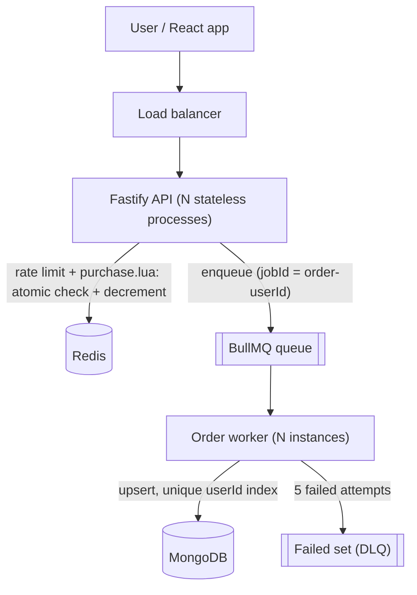

# Arief Shop: Flash Sale System

A single-product, limited-stock flash sale backend: a configurable sale window, hard stock limit, one unit per user, built to hold up when thousands of requests hit the same second.

Monorepo: pnpm workspaces + Turborepo, Fastify API, BullMQ worker, React frontend, Redis for the hot path, MongoDB for the durable record.

## Design, in one paragraph

A purchase attempt never touches the database. It runs one atomic Redis Lua script that checks the sale window (against Redis's own clock), checks if the user already bought, checks stock, and decrements, all in one round trip, so two requests racing for the last unit can't both win. A winning request is handed to a queue (BullMQ, on the same Redis); a separate worker confirms it into MongoDB. The full reasoning, including why this replaces the "acquire lock / grant lock" pattern from the reference diagrams, is in `docs/architecture.md` and `docs/adr/`.

## System diagram

See `docs/architecture.md` for the full diagram and a step-by-step request walkthrough. Short version:



## Repo layout

```
apps/
  api/      Fastify server: sale status, purchase, per-user status, health
  worker/   BullMQ consumer that confirms orders into MongoDB; dlq-replay and reconcile scripts
  web/      React + Vite storefront (public/ holds the favicon, robots.txt and product photos)
packages/
  core/     Shared domain logic: the Lua scripts, Redis/Mongo helpers, order schema, userId rules
stress/     Load test harness + the invariant checks that prove correctness under load
docs/
  PRD.md          design spec, written and approved before any code
  architecture.md full diagram + component writeup
  adr/            one record per major decision, with trade-offs
```

## Build and run

Requires Node 20+ and pnpm. Redis and MongoDB, either installed locally or via Docker.

```bash
# 1. Infra: Redis + MongoDB
docker compose up -d
# (or run redis-server / mongod locally if you already have them)

# 2. Install and build
pnpm install
pnpm build              # builds packages/core first; apps/api and apps/worker import its compiled output

# 3. Copy env and seed the sale window
cp .env.example .env    # already has working defaults; edit SALE_START/SALE_END/SALE_STOCK if you want
pnpm seed                # writes the sale window + stock to Redis, creates the Mongo index

# 4. Run everything
pnpm dev                 # api + worker + web in parallel, via turbo
```

Then open `http://localhost:5173`. The API listens on `:3000`, proxied by Vite's dev server so there's no CORS setup needed.

To run one piece at a time: `pnpm --filter @flashsale/api run dev`, `--filter @flashsale/worker`, `--filter @flashsale/web`.

Production-style run of the built output, using more than one CPU core (see "Scaling" below):

```bash
API_PROCESSES=2 pnpm --filter @flashsale/api start      # 2 API processes sharing :3000
pnpm --filter @flashsale/worker start                    # run this once per worker process you want
```

### Re-seeding

`pnpm seed` refuses to overwrite an already-seeded sale; pass `-- --force` to reset it (useful when the window from `.env.example`'s relative defaults has already passed):

```bash
pnpm --filter @flashsale/api run seed -- --force
```

## API

| Method | Path | Response |
|---|---|---|
| GET | `/api/sale` | `{ status, startsAt, endsAt, totalStock, stockLeft }`, status is `upcoming` / `active` / `ended` / `sold_out` |
| GET | `/api/product` | The product's display data (name, price, photos, specs), `Cache-Control: public, max-age=60`. 404 if not seeded. Not on the purchase path. |
| POST | `/api/purchase` `{ userId }` | 202 `pending`, 409 `already_purchased`, 410 `sold_out`, 403 `upcoming`/`ended`, 400 `invalid_user`, 429 `rate_limited` (per IP, this route only), 503 `unavailable` (Redis or queue down) |
| GET | `/api/purchase/:userId` | `{ userId, status }`, status is `none` / `pending` / `confirmed` |
| GET | `/health` | 200 when Redis and Mongo both respond |

Full outcome table and the reasoning behind each status code: `docs/PRD.md` section 5. Every API response, errors included, carries `X-Frame-Options: DENY`, `Content-Security-Policy: default-src 'none'; frame-ancestors 'none'`, `X-Content-Type-Options: nosniff` and `Referrer-Policy: no-referrer`.

## Storefront

Arief Shop's product page, modeled on a marketplace listing: photo gallery, a flash-sale bar with a live countdown, sale price against the original with the discount, a stock meter, the buy box, then specs and description. It works down to phone width.

Still one product, per the brief. Its display data (name, price, photos, specs) lives in one Mongo document written by `pnpm seed` (`apps/api/src/seed/product.ts`) and served by `GET /api/product`. Nothing about it touches the purchase path: stock, the window, and who bought stay in Redis.

- **SEO**: title, meta description, canonical URL, Open Graph and Twitter card tags in `apps/web/index.html`; schema.org `Product` JSON-LD with live price and availability, updated as the sale status changes; `robots.txt` keeps crawlers off `/api/`. Set `VITE_SITE_URL` to the public URL so canonical and `og:image` links are absolute.
- **Favicon**: `apps/web/public/favicon.svg`.
- **Anti-clickjacking**: the page can't be framed, so a hidden "Buy Now" can't be hijacked. The dev and preview servers send `X-Frame-Options: DENY` and `Content-Security-Policy: frame-ancestors 'none'`; the production preview also sends a full CSP (`default-src 'self'`, no inline scripts), checked with zero violations. `frame-ancestors` can't be set from a `<meta>` tag, so whatever serves the built files in production must send these headers too (see `apps/web/vite.config.ts`).
- **Photos**: by LouisBlaut, CC BY-SA 4.0, via Wikimedia Commons, cropped to squares. Credited in the page footer and `apps/web/public/products/CREDITS.md`. Chosen because they show one hand-made shoe from two sides, with no brand logos.

## Tests

Six layers. Unit and integration run against real Redis and Mongo (there's no fake Redis here; the Lua scripts only mean something inside real Redis).

| Layer | Command | What it proves | Count |
|---|---|---|---|
| Unit | `pnpm test` | Gate logic, mappers, config, seed data, React components, API client, SEO data | 105 (core 54, api 12, worker 2, web 37) |
| Property-based | part of `pnpm test` | fast-check runs hundreds of random purchase/release sequences and concurrent bursts against a plain reference model of the rules | 7 properties |
| Integration | `pnpm test:integration` | Every endpoint and status code, 429/503 paths, security headers on errors too, the real cluster entry point, a real BullMQ worker end to end including the DLQ | 33 (api 28, worker 5) |
| Mutation | `pnpm test:mutation` | Stryker edits the source (flip a `<`, drop a branch) and checks a test fails each time | 100% score on core, api, worker |
| End-to-end | `pnpm test:e2e` | Real Chromium against the running stack, including SEO tags, favicon, and a hostile page failing to frame the shop | 8 |
| Stress | `pnpm stress` | 26,000 requests across 3 scenarios, then invariant checks in Redis and Mongo | 3 scenarios |

Each package's tests use their own Redis db index and Mongo database, so they run in parallel without clashing. To point them at a different Redis/Mongo (another worktree, CI), set `TEST_REDIS_URL` and `TEST_MONGO_URL`.

```bash
pnpm test && pnpm test:integration     # needs Redis + Mongo
pnpm test:mutation                      # ~1 minute
pnpm dev                                # then, in another terminal:
npx playwright install chromium         # one time only
pnpm test:e2e
```

The e2e suite covers the seeded product with its photos actually loading, buy, pending to confirmed, a blocked second purchase, losing the race for the last unit (Playwright's clock freezes the status poll so the page still says "active" when the server has sold out), and the upcoming/ended/sold-out screens. Details in `apps/web/e2e/README.md`.

### Bugs the test layers caught

Worth listing, because each one passed every test that existed before it:

- A numeric userId (`"12345"`) could never buy: BullMQ rejects job ids that parse as integers, so every purchase reserved, failed to enqueue, released, and returned 503. Found in review; regression test added.
- The rate limiter answered 500 instead of 429, and Redis being down answered 500 instead of 503. Found by probing the error paths directly.
- Completed BullMQ jobs were kept forever, and BullMQ silently ignores `add()` for an existing job id. A returning user in a re-seeded sale stayed "pending" forever. Found by the stress test running twice in a row.
- The API cluster re-forked a process that failed at startup (port taken) forever, pinning every CPU. Found while benchmarking; it now exits instead, with a test.
- Mutation testing found `orders.ts` and `isReserved` had no tests inside core, and that a broken `connectMongo` in a `beforeAll` makes Vitest skip tests instead of failing them.

## Stress tests

```bash
API_PROCESSES=2 RATE_LIMIT_MAX=100000 pnpm --filter @flashsale/api start   # limiter opened up for the run
WORKER_CONCURRENCY=25 pnpm --filter @flashsale/worker start                 # twice, in two terminals
pnpm stress
```

Three scenarios: 10,000 users racing for 100 units, 1 user firing 1,000 concurrent attempts, and 5,000 users each retrying 3 times against 2,000 units (the "double-clicking while stock runs out" case). After each one the script waits for the queue to drain and checks Redis and Mongo directly. Expected outcome, and what the last run showed: every invariant passes, exactly 100 / 1 / 2,000 confirmed orders, zero duplicates, stock never negative, around 11,000-13,000 req/s with p99 under 100ms from a single client process. Full output and how to read it: `stress/README.md`.

## Scaling

The API and worker hold no state; every decision lives in Redis. So both scale by running more processes, on one host or many.

- `API_PROCESSES=N` forks N API processes sharing the port. A process that crashes while serving is replaced (tested: killed one with `-9` under traffic, 40 of 40 requests still returned 200). A process that fails at startup stops the whole cluster with exit code 1 instead of fork-looping.
- Workers: start more of them. BullMQ hands each job to exactly one; the last stress run split 2,101 jobs 1,067 / 1,034 across two.

Measured on an 8-core laptop with the load generator on the same machine (purchase endpoint, full Lua path):

| API processes | req/s | p50 latency |
|---|---|---|
| 1 | 33,700 | 5 ms |
| 2 | 52,700 | 3 ms |
| 4 | 42,300 | 4 ms |

Past 2 processes the box runs out of headroom: Redis was at 424,000 ops/s, about 10 Redis operations per purchase (rate-limit counter plus the reads inside the Lua script), while sharing cores with the load generator and the API. The next levers, in order: move rate limiting to the load balancer (cuts Redis work per purchase roughly in half), put Redis on its own host, then shard with Redis Cluster. Details in `docs/architecture.md`.

## Trade-offs worth knowing before reading the code

- Redis is the source of truth during the sale; Mongo is the durable record written after the fact. Faster hot path, at the cost of a `reconcile` step if Redis is ever lost (see `docs/architecture.md`, "Known limits").
- A purchase attempt returns `pending`, not `confirmed`. The frontend renders that exact state on screen.
- Single Redis instance. It's the one thing in this design that's a bottleneck and a single point of failure if traffic outgrows one box. Documented here directly, as the first thing to change for production.
- Rate limiting covers `POST /api/purchase` only. Status reads stay unlimited so a page polling every 2 seconds, or many users behind one office NAT, never spends anyone's purchase budget.

Each of these, plus the ones specific to a single decision (why BullMQ, why MongoDB, why Lua over a lock), has its own ADR in `docs/adr/`.
