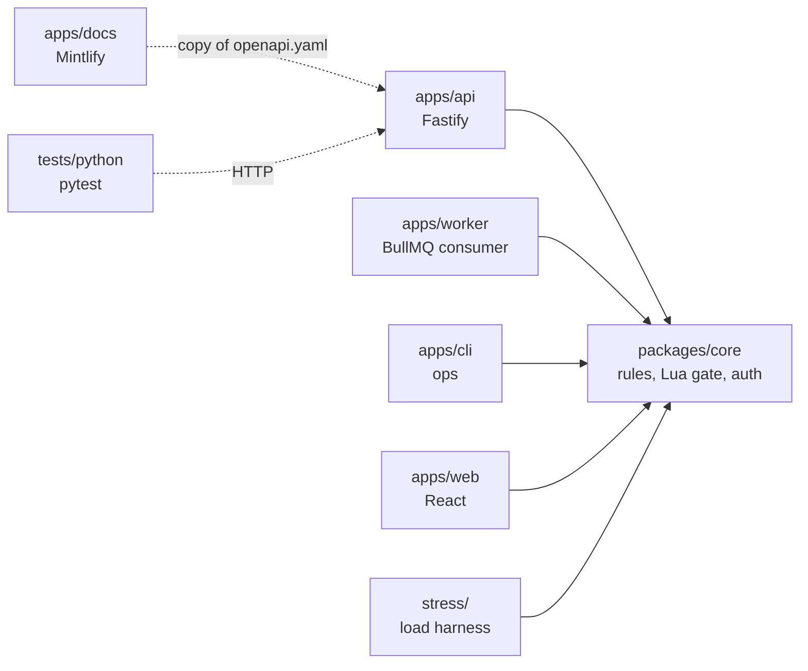

# Repository analysis

A snapshot of the codebase as of 2026-11-18: shape, size, test coverage, where the risk sits, and what to do next. Counts come from `wc -l`, the test runners and `codegraph status`.

## Shape

Every app depends on `packages/core` and on nothing else in the repo. No app imports another app. That's what lets one agent own one package (`.claude/agents/`).

The web app uses core only in `e2e/seed-helper.ts`, to seed test data the same way the CLI does. The browser bundle imports nothing from it; `api.ts` declares its own response types.

## Size

| Package | Source lines | Test lines | Test / source |
|---|---|---|---|
| `packages/core` | 631 | 922 | 1.5 |
| `apps/api` | 646 | 1,067 | 1.7 |
| `apps/worker` | 77 | 124 | 1.6 |
| `apps/cli` | 743 | 931 | 1.3 |
| `apps/web` | 1,084 | 901 | 0.8 |
| `stress` | 317 | (it is a test) | |
| `tests/python` | | 108 | |

About 3,500 lines of TypeScript source in total. CodeGraph indexes 155 files, 970 symbols and 1,695 edges, including 192 functions and 11 HTTP routes.

No source file passes 130 lines. The largest are `apps/web/src/api.ts` (125), `packages/core/src/sale-gate.ts` (110), `apps/api/src/routes/auth.ts` (101), `apps/api/src/routes/purchase.ts` (99) and `apps/api/src/app.ts` (108).

## Tests

| Layer | Count | Status |
|---|---|---|
| Unit + property (Vitest, fast-check) | 286 | green |
| Integration (real Redis + Mongo) | 143 | green |
| Mutation (Stryker) | core, api, worker, cli | 100% |
| End-to-end (Playwright) | 11 | green |
| Contract (pytest, black box) | 7 | green |
| Stress (3 scenarios, invariant checks) | 26,000 requests | all invariants pass |
| Lint (ESLint 10, typescript-eslint, react-hooks) | 6 packages | 0 problems |

Mutation testing has earned its place: it found the `reconcile` DLQ oversell bug, the `beforeAll` trap that skipped tests silently, a Swagger CSP hook that never mattered, and a test that couldn't tell the hand-written OpenAPI spec from a generated one.

The web app has the lowest test-to-source ratio and no mutation testing. Its logic is thin (rendering what the API says), and e2e covers the flows, so this is a reasonable place to be lighter.

## Strengths

- **Correctness lives in one place.** Window, dedupe and stock are one Lua script. Three more layers (fixed job id, unique index, idempotency key) make duplicate orders impossible even when retries go wrong.
- **Dependencies are injected.** `buildApp(deps)`, `SaleGate(redis, now)` and `registerProductRoute({ db, now })` take their outside world as arguments, which is why failure tests can use dead ports instead of mocks.
- **Failure paths are tested, not just described.** Redis down, Mongo down, enqueue failure, saturation, forged sessions and rate limits each have a test asserting the status code.
- **Docs are checked.** Every served route must be in `openapi.yaml`, the docs copy can't drift, and the README counts come from real runs.

## Risks and debt

Ordered by how much they'd hurt in production.

1. **Single Redis is the single point of failure** for the purchase path, the queue and rate limits. Known and documented (README trade-offs, `docs/architecture.md` known limits). First thing to change for a real launch.
2. **Up to ~1 s of reservations can be lost** on a hard Redis crash (AOF `everysec`). `pnpm cli reconcile` rebuilds what reached Mongo or the queue; it can't recover what reached neither.
3. **A reconnect could re-send the purchase script.** ioredis resends unanswered commands after a reconnect by default. If the first `EVALSHA` ran but its reply was lost, the resend sees the buyer already in the set and answers `already_purchased`, so no job gets enqueued. The unit stays reserved but unconfirmed until `reconcile`. Not reproduced; worth one test with a proxy that drops a reply, and possibly `autoResendUnfulfilledCommands: false` on the API client.
4. **The OpenAPI spec is hand-written.** The route list is enforced and the Python suite checks observed status codes against it, but response body shapes are only checked where a test asserts them.
5. **Product cache is per process.** A re-seed shows up within 60 s, at different moments on different processes. Fine for display data; would need a version key if product data ever affected purchases.
6. **No CORS.** On purpose (same-origin app, `SameSite=Strict` cookie), but it means the Mintlify "Try it" button can't reach a local API. Swagger UI at `/docs` covers live calls.
7. **E2E and stress share fixed ports and the dev databases**, so only one agent can run them at a time.

## Recommendations

1. Add the dropped-reply test from risk 3, then decide on `autoResendUnfulfilledCommands`.
2. Before any real traffic: managed Redis with a replica and failover, and rate limiting moved to the gateway (removes about half the Redis work per purchase, see `PERFORMANCE_REVIEW.md`).
3. Add response-body checks to the Python contract suite for the remaining endpoints, or validate responses against the spec in the integration tests.
4. Keep the web app's coverage at e2e plus component tests. Mutation testing there would cost more than it finds.

## Tooling for working on this repo

- `CLAUDE.md` (root and per package) and `AGENTS.md` for agent instructions.
- `.claude/agents/`: one agent per package plus a read-only verifier.
- `.claude/skills/`: ADRs, API changes, read-only database inspection, CodeGraph, TypeScript, style, git, stack.
- `codegraph` for callers, callees and impact (`codegraph impact <symbol>` before touching core).
