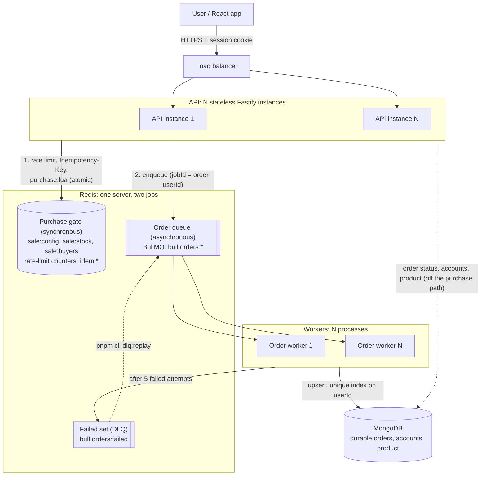

Redis is drawn as one box with two parts because it does two different jobs on one server. The **purchase gate** is read and written inside the request: every API instance runs the same atomic `purchase.lua` against the same keys, which is what makes the decision correct no matter which instance a request lands on. The **order queue** is BullMQ's job list: an instance drops a job and answers `202 pending` at once, and whichever worker is free writes the durable order to MongoDB afterwards. The buyer only waits for the gate. In production the two can move to separate Redis instances.

Locally there's no load balancer box: `API_PROCESSES=N` runs N API processes on one host, and you start as many workers as you like. Both API and worker are stateless, so every copy talks to the same Redis and Mongo and you can run as many as traffic needs.

## Components

| Component | Job |
|---|---|
| React storefront | Renders what the API says. Polls `GET /api/sale` every 2 s, posts to `/api/purchase`, then polls `/api/purchase/me` until `confirmed`. Can't be framed. |
| Fastify API | Stateless. Verifies the session in memory, rate limits per account, runs `purchase.lua`, enqueues the winner. No database call on the purchase path. |
| Redis | The atomic purchase gate (window, dedupe, stock) and the BullMQ backing store. |
| BullMQ + workers | Turn a reservation into a durable order. Upsert on a unique `userId` index, so a retried job is harmless. |
| MongoDB | Confirmed orders, accounts, reset tokens, product display data, the email outbox. |
| DLQ | BullMQ's failed set. A job that fails 5 times waits there for `pnpm cli dlq:replay`. |
| Ops CLI | Seed, inject product, clean users, reset, replay the DLQ, reconcile Redis from Mongo. |

## Request walkthrough

1. User clicks "Buy Now." Frontend posts to `POST /api/purchase`; the browser sends the session cookie.
2. API verifies the session signature (401 if missing, forged or expired), takes the email from it as the buyer, and applies the per-user rate limit. If the request carries an `Idempotency-Key`, the API claims it atomically in Redis (`SET NX`, 24 h, scoped to the account): a key it has already answered gets that same answer back, a key still in flight gets 409 `in_progress`. Then it runs `purchase.lua`.
3. Script outcome decides the response:
   - `upcoming` / `ended` → 403, sale isn't open.
   - `already_purchased` → 409, this user already has a unit.
   - `sold_out` → 410, nothing left.
   - `reserved` → unit decremented and buyer recorded, inside the script, atomically.
4. On `reserved`, API enqueues `{ userId, reservedAt }` with `jobId = order-<userId>` (BullMQ rejects bare-integer ids, and a numeric userId is valid), returns `202 pending`. Completed jobs are removed so the same user can be enqueued again in a later sale.
5. If the enqueue itself throws, the API runs `release.lua` to give the unit back and returns `503`, so the user can retry instead of a unit vanishing into nothing.
6. A worker (one of possibly many) picks up the job and upserts the confirmed order into Mongo.
7. The API stores the response under the idempotency key, except a 503, which is worth retrying, so the key is released instead.
8. Frontend, seeing `pending`, polls `GET /api/purchase/me` until the response flips to `confirmed`.

## Scaling

Measured, not guessed. 8-core laptop, load generator on the same box, purchase endpoint going through the full Lua path:

| API processes | req/s | p50 |
|---|---|---|
| 1 | 33,700 | 5 ms |
| 2 | 52,700 | 3 ms |
| 4 | 42,300 | 4 ms |

Two processes add 56%. Four is worse than two because the box is out of headroom: Redis was at 424,000 ops/s, roughly 10 Redis operations per purchase (the rate limiter's counter script plus the reads inside `purchase.lua`, both counted), while sharing cores with four API processes and the load generator.

- **API and worker**: stateless, scale by running more of them. BullMQ hands each job to exactly one worker; two workers split 2,101 jobs 1,067 / 1,034 in the last stress run.
- **Redis**: the shared point. Levers, cheapest first: (1) move rate limiting to the load balancer or an API gateway, which removes about half the Redis work per purchase; (2) give Redis its own host so it isn't fighting the API for CPU; (3) Redis Cluster. The gate's three keys (`sale:config`, `sale:stock`, `sale:buyers`) are one sale, so they'd go in one hash slot via a `{sale}` hash tag; more throughput beyond one shard means splitting stock into N buckets, each its own slot, and routing each user to one bucket by hash. Dedupe still holds (a user always lands in the same bucket); the cost is fairness, since one bucket can sell out while another still has units.
- **Mongo**: writes are paced by worker concurrency, not by request volume, so this rarely becomes the bottleneck first. One collection keyed by `userId`, which shards cleanly.

## Known limits

Documented instead of hidden, matching PRD section 8:

- Redis runs with AOF (`appendfsync everysec`). A hard crash can lose up to ~1 second of reservations that hadn't yet reached the queue. `pnpm cli reconcile` rebuilds `sale:buyers`/`sale:stock` from Mongo's confirmed orders plus every unconfirmed job still in Redis, DLQ included (a DLQ job will confirm an order when replayed, so its user keeps their unit), but it can't recover a reservation that never reached either store, and it can't recover the sale's start/end/stock numbers if `sale:config` itself was lost (re-seeding with the original values is the only recovery there).
- Single Redis instance is a single point of failure for the entire purchase path. Acceptable for this exercise's scope; called out as the first thing to change for a real production deployment.
