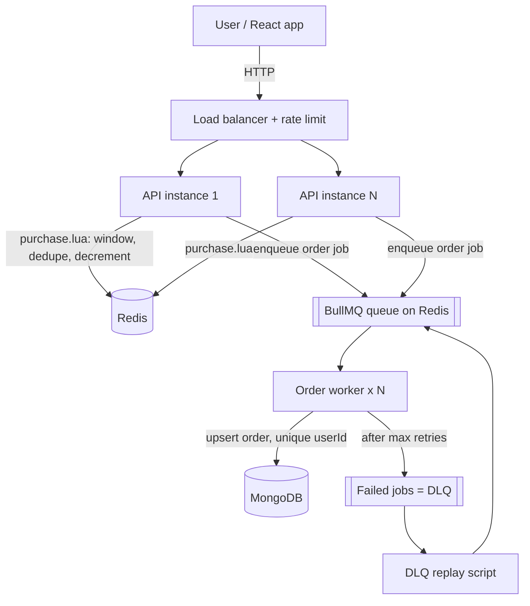

# PRD: High-Throughput Flash Sale

Owner: Arief Fitranto
Status: Implemented. Two deviations from this plan, both recorded as ADRs: the stress harness uses a custom fetch-based load generator instead of autocannon (`docs/adr/0006`), and an end-to-end Playwright suite (`apps/web/e2e/`) was added after this PRD was written.
Deadline: 2026-11-22 18:20 AEDT

## 1. Problem

One product, limited stock, a fixed sale window, thousands of users hitting "Buy" at the same second. Each user gets at most one unit. We must never oversell, never sell twice to the same user, and keep answering requests while under load.

## 2. Goals

1. Correct under concurrency: zero oversell, zero duplicate buyers.
2. Fast hot path: a purchase attempt touches Redis only, never the database.
3. Survives partial failure: worker crash, Redis restart, enqueue failure.
4. Simple enough to read in one sitting. Small code, boring tools.
5. Scales horizontally: API and workers are stateless and can run as many copies as needed.

Out of scope: payments, auth, multiple products, admin UI, cloud deployment.

## 3. Stack

| Layer | Choice | Why |
|---|---|---|
| Monorepo | pnpm workspaces + Turborepo | One repo, one install, cached builds |
| API | Node 24, Fastify, TypeScript | Fast, built-in schema validation, `inject()` for tests |
| Hot path store | Redis 7+ | Atomic Lua scripts, single-threaded, sub-ms |
| Queue | BullMQ (on the same Redis) | Retries, backoff, failed set used as DLQ. Local stand-in for SQS |
| Database | MongoDB 8 | Durable order records. Unique index on `userId`. MERN as requested |
| Worker | Node, TypeScript, BullMQ worker | Writes orders to Mongo off the hot path |
| Frontend | React + Vite | Simple single page |
| Tests | Vitest | Unit + integration, same runner everywhere |
| Stress | autocannon (programmatic) | Node native, lets us send a unique user per request |
| Local infra | docker-compose (mongo, redis) | Reviewers don't need Homebrew installs |

Mongo was confirmed to start on this machine (`mongod` 8.0.10), so Postgres is not needed.

## 4. Architecture

Both reference drawings merged into one. The "Acquire Lock / Grant Lock" step from drawing 2 is replaced by a single Redis Lua script. A Lua script runs atomically inside Redis, so the check-and-decrement can't interleave with another request. That gives the same guarantee as a lock with one round trip instead of three, and no lock to leak if a process dies holding it.



Locally the load balancer is not run. The rate limit lives in the API (`@fastify/rate-limit`, Redis backed so it holds across instances). The API is stateless, so in production you put N copies behind any LB.

### Purchase flow

1. API normalizes `userId` (trim, lowercase, max length, required).
2. API runs `purchase.lua` with keys `sale:config`, `sale:stock`, `sale:buyers`:
   - read the window from `sale:config`, current time from Redis `TIME` (one clock for all instances)
   - before start: return `upcoming`. After end: return `ended`
   - `SISMEMBER sale:buyers userId`: if yes, return `already_purchased`
   - `GET sale:stock`: if <= 0, return `sold_out`
   - `DECR sale:stock`, `SADD sale:buyers userId`, return `reserved`
3. On `reserved`, API enqueues job `{ userId, reservedAt }` with `jobId = userId` (BullMQ drops duplicate job IDs).
4. If enqueue throws, API runs `release.lua` (`SREM` + `INCR`, only if the user was in the set) and returns 503. The user can try again.
5. API returns 202 `pending`.
6. Worker upserts `{ userId, status: "confirmed", createdAt }` into Mongo `orders`. Unique index on `userId` makes a replayed job a no-op.

### Status check flow

`GET /api/purchase/:userId`: look in Mongo first. Found means `confirmed`. Not in Mongo but in `sale:buyers` means `pending`. Neither means `none`.

## 5. API

All responses are JSON. Errors use `{ error, message }`.

| Method | Path | Result |
|---|---|---|
| GET | `/api/sale` | 200 `{ status: "upcoming" \| "active" \| "ended" \| "sold_out", startsAt, endsAt, stockLeft, totalStock }` |
| POST | `/api/purchase` body `{ userId }` | see table below |
| GET | `/api/purchase/:userId` | 200 `{ userId, status: "confirmed" \| "pending" \| "none" }` |
| GET | `/health` | 200 when Redis and Mongo respond |

`POST /api/purchase` outcomes:

| Outcome | HTTP | Body `status` |
|---|---|---|
| Reserved | 202 | `pending` |
| Same user again | 409 | `already_purchased` |
| No stock | 410 | `sold_out` |
| Before start | 403 | `upcoming` |
| After end | 403 | `ended` |
| Bad userId | 400 | `invalid_user` |
| Rate limited | 429 | `rate_limited` |
| Redis or queue down | 503 | `unavailable` |

## 6. Frontend

Single page, React + Vite, talks to the API through a Vite dev proxy.

Acceptance:
- [ ] Shows sale status, countdown to start or end, and stock left. Polls `/api/sale` every 2s.
- [ ] Text input for user identifier.
- [ ] "Buy Now" button, disabled when sale is not active or a request is in flight.
- [ ] Clear message for each outcome: pending, confirmed, already purchased, sold out, not started, ended, rate limited, server error.
- [ ] After a `pending` result, polls `/api/purchase/:userId` until `confirmed`.

## 7. Configuration

Env vars, with defaults in `.env.example`:

| Var | Default | Note |
|---|---|---|
| `SALE_START` | now + 1 min | ISO time |
| `SALE_END` | now + 1 hour | ISO time |
| `SALE_STOCK` | 100 | |
| `REDIS_URL` | `redis://localhost:6379` | |
| `MONGO_URL` | `mongodb://localhost:27017/flashsale` | |
| `RATE_LIMIT_MAX` | 5 per second per IP | Stress runs set this high, see section 9 |
| `PORT` | 3000 | |

A `seed` script writes config and stock into Redis and creates the Mongo index. It refuses to overwrite a running sale unless `--force` is passed.

## 8. Failure handling

| What breaks | What happens |
|---|---|
| Two requests race for the last unit | Lua script is atomic, only one gets `reserved` |
| Same user sends 50 requests at once | First wins, the other 49 get `already_purchased` |
| Enqueue fails after reservation | `release.lua` gives the unit back, user gets 503 and can retry |
| Worker crashes mid-job | BullMQ marks the job stalled and another worker picks it up |
| Mongo is down | Job retries with exponential backoff, 5 attempts, then moves to failed set (DLQ) |
| Job processed twice | Upsert with unique `userId` index, second write changes nothing |
| DLQ has jobs | `pnpm dlq:replay` moves failed jobs back to the queue once Mongo is healthy |
| Redis restarts | AOF persistence (`appendfsync everysec`) in docker-compose. `pnpm reconcile` rebuilds `sale:buyers` and `sale:stock` from Mongo plus pending jobs if needed |
| Traffic spike beyond capacity | Rate limit returns 429 early, before Redis work |

Known limit: with `everysec`, a Redis crash can lose up to 1s of reservations that were not yet enqueued. Jobs already in the queue are safe. Stated in the README.

## 9. Testing

Unit (Vitest, real Redis on a test DB index):
- [x] `purchase.lua`: upcoming, ended, sold out, duplicate user, success decrements stock
- [x] `release.lua`: only releases a user that holds a reservation
- [x] `userId` normalization
- [x] status mapping (Mongo + Redis to `confirmed` / `pending` / `none`)

Integration (Fastify `inject`, real Redis + Mongo):
- [x] each endpoint, each status code in section 5
- [x] purchase then worker run then status reads `confirmed`
- [x] enqueue failure triggers release
- [x] worker idempotency: same job twice gives one order
- [x] numeric userId (not in the original plan; BullMQ rejects a bare job id that parses as an integer, caught during review, see `apps/api/src/routes/purchase.ts`'s `orderJobId`)

Stress (`pnpm stress`, `RATE_LIMIT_MAX` raised for the run). Built with a custom fetch-based load generator instead of autocannon, see ADR 0006 for why:
- [x] Scenario A: 10,000 unique users, stock 100.
- [x] Scenario B: one user, 1,000 concurrent requests.
- [x] Scenario C: 5,000 users each sending 3 requests.

After the queue drains, the script asserts and prints:
- [x] confirmed orders in Mongo == min(stock, unique users)
- [x] no `userId` appears twice in Mongo
- [x] `sale:stock` never below 0 (ends at 0 when sold out)
- [x] pending (202) count matches confirmed-order count once drained, implied by the no-overselling check since both equal `min(stock, unique users)` by construction
- [x] throughput, p50 / p95 / p99 latency, count per status code

End-to-end (Playwright, added after this PRD, see `apps/web/e2e/`):
- [x] buy, pending, confirmed, blocked second purchase
- [x] Buy button disables itself once the sale snapshot reports `sold_out`

## 10. Repo layout

```
flashsale/
  apps/
    api/        Fastify server
    worker/     BullMQ order worker + dlq replay
    web/        React + Vite
  packages/
    core/       Lua scripts, Redis keys, types, userId rules (shared by api and worker)
  stress/       autocannon scenarios + invariant checks
  docs/
    PRD.md
    architecture.md
  docker-compose.yml
  turbo.json    (uses the v2 "tasks" key)
  CLAUDE.md
  README.md
```

Root scripts: `dev`, `build`, `test`, `test:integration`, `stress`, `seed`, `dlq:replay`, `reconcile`, `lint`, `typecheck`.

## 11. Deliverables (maps to the brief)

- [ ] Git repo with source (code is written and tested; nothing has been committed yet, see the final summary)
- [x] README: design choices and trade-offs
- [x] README: Mermaid system diagram
- [x] README: build and run (server, frontend, tests)
- [x] README: how to run stress tests and expected outcome, with a real result pasted in
- [x] CLAUDE.md: how to work in this repo, commands, invariants not to break
- [x] docs/architecture.md: the "why" behind each component

## 12. Milestones

1. Scaffold monorepo, docker-compose, `packages/core` with Lua scripts + unit tests.
2. API endpoints + integration tests.
3. Worker, DLQ replay, reconcile + tests.
4. React frontend.
5. Stress scenarios, run them, record results.
6. README, architecture doc, CLAUDE.md. Final pass: fresh clone, follow README, everything works.

## 13. Trade-offs to explain in review

- Redis as the source of truth during the sale, Mongo as the durable record. Faster hot path, at the cost of a reconcile step if Redis is lost.
- Lua script instead of a distributed lock. One round trip, nothing to expire or leak.
- Async order write through a queue. The user sees `pending` for a moment, and the database never sees the spike.
- BullMQ instead of SQS or RabbitMQ. Same semantics (retries, DLQ), no extra infra to run locally. Swapping to SQS only touches the enqueue and worker adapters.
- Single Redis is a single point of failure. In production: Redis with replica + Sentinel, or a managed service. Out of scope here.
