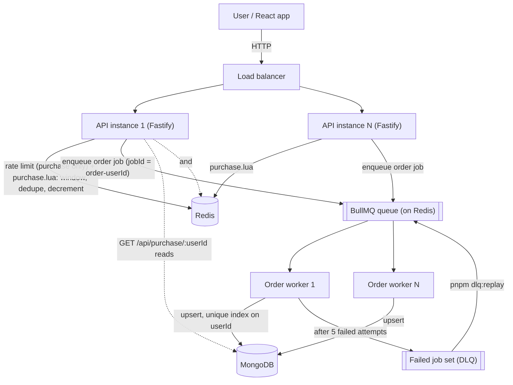

# Architecture

This redraws the two reference diagrams (load balancer + lock pattern, and order service + queue + DLQ pattern) as one system, with the lock replaced by an atomic Redis script. The reasoning behind each swap is in `docs/adr/`.

## Diagram

Locally the load balancer box isn't run; `API_PROCESSES=N` gives N API processes on one host instead, and you start as many workers as you like. The diagram shows the shape that scales: both API and worker are stateless and can run as many copies as traffic needs, because every copy talks to the same Redis and Mongo.

## Components

**React frontend.** Polls `GET /api/sale` every 2 seconds for status and stock, posts to `/api/purchase` on "Buy Now", and after a `pending` result polls `GET /api/purchase/:userId` until it reads `confirmed`. No business logic lives here; it only renders what the API says.

**Load balancer + rate limit.** In production, any LB in front of N API instances. The rate limit itself lives in the API (`@fastify/rate-limit`, backed by Redis so the count holds across instances) and covers `POST /api/purchase` only. Status reads stay unlimited: the page polls every 2 seconds, and many users can share one office NAT IP, so limiting reads would spend people's purchase budget on polling.

**API (Fastify).** Stateless. `API_PROCESSES=N` forks N copies sharing the port on one host (Node's cluster module, round robin), the same shape as N containers behind an LB. A copy that crashes while serving is replaced; one that dies before it ever listens (port taken, Redis unreachable at boot) shuts the cluster down with exit code 1, because a replacement would hit the same error and fork-loop. The only thing it does on the purchase hot path is run `purchase.lua` against Redis and, if that reserves a unit, enqueue a job. No database call on this path. See `apps/api/src/routes/purchase.ts`.

**Redis.** Two jobs, both justified in the ADRs: the atomic purchase gate (window, dedupe, stock) via Lua scripts, and the backing store for the BullMQ queue. One instance, so it's also the one component this design doesn't horizontally scale (see "Known limits" below).

**BullMQ queue + workers.** Decouples "tell the user their unit is reserved" from "write the durable record." A worker calls `confirmOrder`, an upsert keyed on `userId`'s unique index, so processing the same job twice (a retry, a replayed DLQ job) is harmless.

**MongoDB.** The system of record for confirmed orders. One collection, one document shape, one unique index. Queried by the status endpoint and by the stress harness's invariant checks.

**DLQ (BullMQ's failed set).** A job that fails 5 times (exponential backoff) lands here instead of disappearing. `apps/worker/src/scripts/dlq-replay.ts` moves failed jobs back onto the queue once whatever broke (usually Mongo being unreachable) is fixed.

## Request walkthrough

1. User clicks "Buy Now." Frontend posts `{ userId }` to `POST /api/purchase`.
2. API normalizes the userId (trim, lowercase) and runs `purchase.lua`.
3. Script outcome decides the response:
   - `upcoming` / `ended` → 403, sale isn't open.
   - `already_purchased` → 409, this user already has a unit.
   - `sold_out` → 410, nothing left.
   - `reserved` → unit decremented and buyer recorded, inside the script, atomically.
4. On `reserved`, API enqueues `{ userId, reservedAt }` with `jobId = order-<userId>` (BullMQ rejects bare-integer ids, and a numeric userId is valid), returns `202 pending`. Completed jobs are removed so the same user can be enqueued again in a later sale.
5. If the enqueue itself throws, the API runs `release.lua` to give the unit back and returns `503`, so the user can retry instead of a unit vanishing into nothing.
6. A worker (one of possibly many) picks up the job and upserts the confirmed order into Mongo.
7. Frontend, seeing `pending`, polls `GET /api/purchase/:userId` until the response flips to `confirmed`.

## Scaling this further

Measured, not guessed. 8-core laptop, load generator on the same box, purchase endpoint going through the full Lua path:

| API processes | req/s | p50 |
|---|---|---|
| 1 | 33,700 | 5 ms |
| 2 | 52,700 | 3 ms |
| 4 | 42,300 | 4 ms |

Two processes add 56%. Four is worse than two because the box is out of headroom: Redis was at 424,000 ops/s, roughly 10 Redis operations per purchase (the rate limiter's counter script plus the reads inside `purchase.lua`, both counted), while sharing cores with four API processes and the load generator.

- **API and worker**: stateless, scale by running more of them. BullMQ hands each job to exactly one worker; two workers split 2,101 jobs 1,067 / 1,034 in the last stress run.
- **Redis**: the shared point. Levers, cheapest first: (1) move rate limiting to the load balancer or an API gateway, which removes about half the Redis work per purchase; (2) give Redis its own host so it isn't fighting the API for CPU; (3) Redis Cluster. The gate's three keys (`sale:config`, `sale:stock`, `sale:buyers`) are one sale, so they'd go in one hash slot via a `{sale}` hash tag; more throughput beyond one shard means splitting stock into N buckets, each its own slot, and routing each user to one bucket by hash. Dedupe still holds (a user always lands in the same bucket); the cost is fairness, since one bucket can sell out while another still has units.
- **Mongo**: writes are paced by worker concurrency, not by request volume, so this rarely becomes the bottleneck first. One collection keyed by `userId`, which shards cleanly.

## Known limits

Documented instead of hidden, matching PRD section 8:

- Redis runs with AOF (`appendfsync everysec`). A hard crash can lose up to ~1 second of reservations that hadn't yet reached the queue. `apps/worker/src/scripts/reconcile.ts` rebuilds `sale:buyers`/`sale:stock` from Mongo's confirmed orders plus whatever's still in the queue, but it can't recover a reservation that never reached either store, and it can't recover the sale's start/end/stock numbers if `sale:config` itself was lost (re-seeding with the original values is the only recovery there).
- Single Redis instance is a single point of failure for the entire purchase path. Acceptable for this exercise's scope; called out as the first thing to change for a real production deployment.
