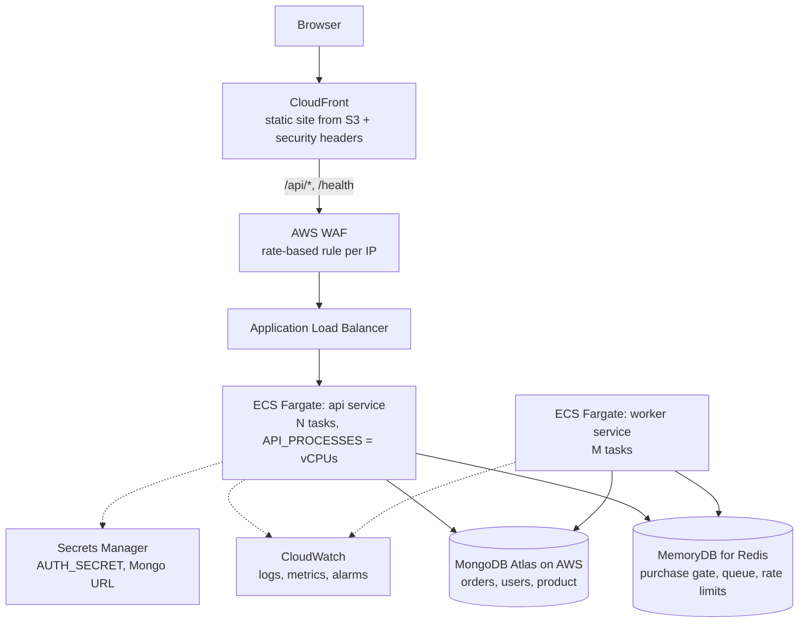

# Deploying to AWS

How this system maps onto AWS, and the steps to stand it up. The containers are the ones built by the root `Dockerfile` and exercised in CI by `docker-compose.full.yml`, so what runs locally is what ships.

## Shape

| Piece | AWS service | Why this one |
|---|---|---|
| Storefront | S3 + CloudFront | Static files, cached at the edge. A CloudFront response headers policy sends the same CSP and `X-Frame-Options: DENY` as `deploy/nginx.conf` |
| API routing | CloudFront behavior `/api/*` and `/health` → ALB | Same origin as the site, so the `SameSite=Strict` session cookie works without CORS |
| Edge rate limit | AWS WAF rate-based rule on the ALB or CloudFront | Stops floods before they cost a Redis call; the API's own per-account limits stay |
| API | ECS on Fargate, `api` target | Stateless; scale by task count. Health check `GET /health` |
| Worker | ECS on Fargate, `worker` target | Scale by task count; each job goes to one worker |
| Redis | **Amazon MemoryDB** (Redis OSS / Valkey compatible) | Durable, Multi-AZ transaction log. Redis is the purchase gate's source of truth during the sale, so losing a write means losing a reservation. ElastiCache works too, but its replication is asynchronous: a failover can drop the last writes |
| MongoDB | **MongoDB Atlas on AWS** (same region, private endpoint) | Real MongoDB: unique and TTL indexes, `findOneAndDelete`, as tested. Amazon DocumentDB is an option but is only API-compatible: run the integration suite against it before choosing it |
| Secrets | Secrets Manager → ECS task secrets | `AUTH_SECRET` (at least 32 random characters), `MONGO_URL` |
| Images | ECR | Pushed from CI |
| Email | SES | Replace the outbox write in `packages/core/src/auth/outbox.ts` with an SES send |
| Observability | CloudWatch Logs + alarms | The API logs JSON (pino) to stdout |

## Environment per service

| Variable | api | worker | Notes |
|---|---|---|---|
| `NODE_ENV` | `production` | `production` | Requires a real `AUTH_SECRET`; secure cookies on |
| `AUTH_SECRET` | secret | secret | Same value on every API task |
| `REDIS_URL` | MemoryDB endpoint (`rediss://`) | same | TLS on |
| `MONGO_URL` | Atlas private endpoint | same | From Secrets Manager |
| `TRUST_PROXY` | `1` | | Behind the ALB, per-IP auth limits must read `X-Forwarded-For` |
| `API_PROCESSES` | vCPUs per task | | One Node process per core |
| `WEB_URL` | public site URL | | Links in reset emails |
| `WORKER_CONCURRENCY` | | 25 | Bounded by Mongo write capacity |
| `RATE_LIMIT_MAX`, `AUTH_RATE_LIMIT_MAX` | 5, 10 | | Per account per second; per IP per minute |

The web image is not used on AWS: `pnpm --filter @flashsale/web build` with `VITE_SITE_URL` set to the public URL, then sync `apps/web/dist` to S3.

## Steps

1. **Network.** A VPC with private subnets in 2+ AZs for ECS tasks and MemoryDB, public subnets for the ALB. Atlas peered or via PrivateLink.
2. **Data.** MemoryDB cluster (1 shard, 1+ replica, TLS). Atlas M10+ cluster in the same region. Put both endpoints and a fresh `AUTH_SECRET` (`openssl rand -hex 32`) in Secrets Manager.
3. **Images.** In CI, after the checks pass on `main`: `docker build --target api` and `--target worker`, push to ECR tagged with the commit SHA.
4. **Seed once.** Run the `cli` target as a one-off ECS task: `seed --start <ISO> --end <ISO> --stock <N>`. Drop the demo account in production (it's for local demos).
5. **Services.** ECS service `api` behind the ALB (target group health check `/health`, deregistration delay 15 s) and service `worker` with no load balancer. Task `stopTimeout` 30 s, so graceful shutdown (10 s drain, ADR 0012) always finishes.
6. **Edge.** S3 bucket (private, CloudFront origin access control) with the web build; CloudFront with two origins (S3 default, ALB for `/api/*` and `/health`, caching disabled except what `Cache-Control` allows: `GET /api/sale` sends `s-maxage=1`). Attach a response headers policy with the CSP from `deploy/nginx.conf`. WAF with a rate-based rule.
7. **Alarms.** 5xx and 503 rate on the ALB, DLQ size (`ZCARD bull:orders:failed` via a scheduled task or a metric from the worker), MemoryDB CPU and memory, ECS task count.

## CI/CD

Two GitHub Actions workflows:

| Workflow | When | What |
|---|---|---|
| `ci.yml` | every push and PR | lint, typecheck, unit + integration (Redis and Mongo service containers), Playwright e2e, Docker build + full-stack purchase smoke test; mutation tests on `main` |
| `release.yml` | after CI passes on `main`, or by hand | builds the `api`, `worker`, `web` and `cli` images and pushes them to GitHub Container Registry as `ghcr.io/<owner>/flashsale-<target>:<commit sha>` and `:latest`; then deploys to ECS if AWS is configured |

The deploy job is opt-in. It runs only when these repository variables exist (Settings, Secrets and variables, Actions, Variables), and uses the `production` environment, so you can require a manual approval there:

| Variable | Example |
|---|---|
| `AWS_DEPLOY_ROLE_ARN` | `arn:aws:iam::123456789012:role/github-flashsale-deploy` (trusted for GitHub OIDC, no long-lived keys) |
| `AWS_REGION` | `ap-southeast-2` |
| `ECR_REGISTRY` | `123456789012.dkr.ecr.ap-southeast-2.amazonaws.com` |
| `ECS_CLUSTER` | `flashsale` |
| `PUBLIC_URL` | `https://shop.example.com` (baked into the web build) |

It copies the exact image CI tested from GHCR into ECR (no rebuild), renders `deploy/ecs/<service>-task-definition.json` with that image, and updates the ECS services `flashsale-worker` then `flashsale-api`, waiting for each to become stable. Fill in the account IDs, region and secret ARNs in those two task definition files first.

The web build goes to S3 + CloudFront separately (`aws s3 sync apps/web/dist s3://<bucket>` then a CloudFront invalidation); add it as a step when the bucket exists.

## Before the sale opens

- **Pre-scale, don't autoscale into the spike.** Use ECS scheduled scaling to raise the `api` and `worker` task counts 15 minutes before `startsAt`; target tracking on CPU can handle the tail.
- **Rehearse.** Run `pnpm stress` against a staging stack with production-sized tasks. The invariants must pass, and note the req/s per task.
- **Check the window.** `pnpm cli status` (as the one-off task) shows the start, end and stock Redis will enforce.

## After the sale

- Watch the DLQ drain to zero; `dlq:replay` after fixing whatever failed.
- Compare buyers in Redis with orders in Mongo (`status`). Only run `reconcile` after understanding a gap.
- Scale back down.

## Cost and simplicity notes

For a one-off sale, the smallest sensible setup is 2 API tasks, 2 worker tasks, a 2-node MemoryDB cluster and an Atlas M10, all in one region. Everything here is standard managed AWS; there is nothing custom to operate except the two container images.
